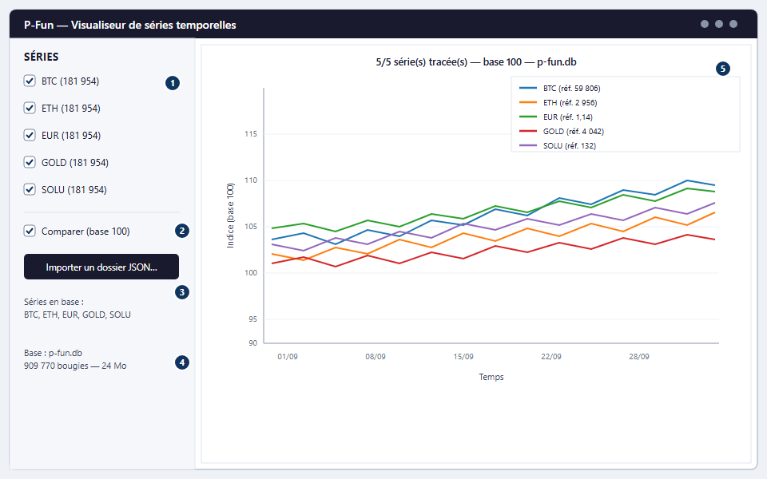
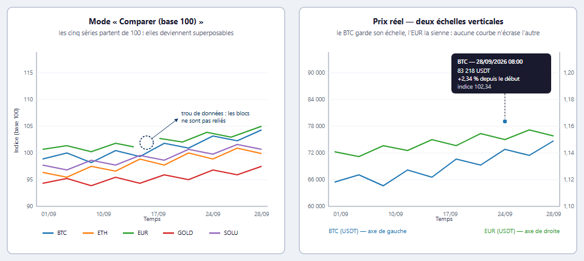
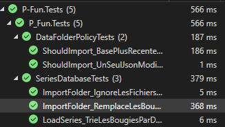

# Rapport de Projet — P-Fun


| | |
|---|---|
| **Projet** | P-Fun |
| **Auteur** | Damien Rochat |
| **Date de rendu** | *30 octobre 2026* |
| **Encadrant** | *M. Carrel* |

---

## Table des matières


1. [Introduction](#1-introduction)
   - 1.1 [Objectifs du projet](#11-objectifs-du-projet)
   - 1.2 [Description du domaine](#12-description-du-domaine)
2. [Analyse fonctionnelle](#2-analyse-fonctionnelle)
3. [Planification initiale](#3-planification-initiale)
4. [Rapport de tests](#4-rapport-de-tests)
5. [Usage de l'intelligence artificielle dans le projet](#5-usage-de-lintelligence-artificielle-dans-le-projet)
6. [Bilan du déroulement du projet](#6-bilan-du-déroulement-du-projet)
7. [Bilan produit](#7-bilan-produit)
8. [Conclusion](#8-conclusion)

---

## 1. Introduction

### 1.1 Objectifs du projet

#### Objectifs produit

Le but du projet est de créer un logiciel qui affiche des graphiques de séries temporelles. Concrètement, le programme doit permettre :

- d'afficher plusieurs séries en même temps sur un même graphique, pour pouvoir les comparer ;
- de stocker les données en local dans une base SQLite, pour pouvoir les consulter sans connexion (les fichiers JSON servent de format d'import) ;
- d'importer de nouvelles données au format JSON (klines Binance) et de les fusionner avec celles déjà stockées ;
- de zoomer, de naviguer dans le temps et de choisir les séries à afficher ou masquer.

On a choisi le domaine de la cryptomonnaie. Par exemple, on pourra comparer l'évolution du Bitcoin et de l'Ethereum sur la même période et voir laquelle a le mieux performé.

#### Objectifs pédagogiques

Le projet doit me faire pratiquer ce qu'on a vu au module 323 :

- utiliser LINQ au lieu des boucles for/foreach classiques ;
- écrire au moins deux extensions du langage C# ;
- approfondir le C# (API REST, JSON, interface graphique WinForms) ;
- découvrir la librairie ScottPlot pour les graphiques ;
- suivre une démarche de projet complète : user stories, maquettes, planification, tests unitaires et journal de travail.

### 1.2 Description du domaine

#### Le domaine d'application

On a choisi la cryptomonnaie et la finance en général. C'est un domaine qui produit beaucoup de données : les marchés sont ouverts 24h/24, 7j/7, et les prix changent en permanence. C'est donc adapté pour des séries temporelles.

Comparer plusieurs cryptomonnaies sur un même graphique est utile pour voir :

- quelles monnaies ont le mieux performé sur une période donnée ;
- si les monnaies évoluent de la même façon (le Bitcoin et l'Ethereum bougent souvent ensemble) ou au contraire se démarquent ;
- lesquelles sont plus volatiles que d'autres.

#### Les séries de données choisies

Le cahier des charges demande au moins 5 séries cohérentes de 500 valeurs minimum. On a pris 5 paires cotées contre l'USDT, un stablecoin qui vaut environ 1 dollar :

| Série | Description |
|:---|:---|
| BTC/USDT | Bitcoin, la référence du marché |
| ETH/USDT | Ethereum, la deuxième plus grosse capitalisation |
| SOL/USDT | Solana, une alternative plus récente |
| PAXG/USDT | PAX Gold, un actif adossé à l'or physique |
| EUR/USDT | Le cours de l'euro face au dollar |

Ces séries sont cohérentes entre elles parce qu'elles sont toutes cotées dans la même unité, l'USDT : on peut les afficher sur un même graphique et comparer leurs variations, sans conversion. Les trois premières sont des cryptomonnaies, la quatrième suit l'or et la cinquième une devise ; c'est justement ce mélange qui rend l'échelle des prix ingérable sans le mode « base 100 » (voir §7.1). Chaque série contient 181 954 bougies à la minute, du 25 mai au 28 septembre 2026, soit 909 770 bougies stockées au total.

Les fichiers de données gardent les noms historiques `btc.json`, `eth.json`, `solu.json`, `gold.json` (PAXG) et `eur.json` (EUR) ; c'est le nom du fichier qui devient le nom de la série.

#### Les sources de données

Les données viennent de l'API publique de Binance (`https://api.binance.com`). On utilise l'endpoint des klines (chandeliers), qui renvoie pour une paire donnée l'historique des prix : ouverture, clôture, plus haut, plus bas et volume, pour un intervalle choisi (1h, 1 jour, etc.). Cette API est gratuite et ne demande pas d'inscription pour les données publiques. Elle renvoie du JSON.

Un script fourni avec le projet (`scripts/fetch_binance_data.py`) interroge cette API et écrit la réponse telle quelle dans un fichier JSON par paire. Ces fichiers sont ensuite importés dans la base SQLite locale (`data/p-fun.db`) ; l'application ne lit plus que la base, ce qui permet de travailler hors ligne. Le script ne dépend que de la bibliothèque standard de Python et pagine les appels, l'API ne renvoyant pas plus de 1000 bougies par requête.


---

## 2. Analyse fonctionnelle

### 2.1 User stories

Les user stories ont été rédigées au début du projet, avant le code, comme demandé dans le cahier des charges. Elles sont suivies sur le projet Kanban GitHub et dans les issues du repo.

| ID | User story | Priorité |
|:---|:---|:---:|
| US1 | Affichage des 5 séries au lancement de l'application | Haute |
| US2 | Choix des séries affichées ou masquées | Haute |
| US3 | Stockage local des séries, travail hors connexion | Haute |
| US4 | Import de données (CSV, JSON, API) | Haute |
| US5 | Flexibilité d'affichage pour analyser les données | Moyenne |

#### US1 – Affichage

> En tant qu'utilisateur, je veux que quand je lance l'application, une fenêtre s'ouvre avec les 5 séries, afin de visualiser rapidement le cours des cryptomonnaies.

**Scénario 1 : Affichage des 5 séries principales au lancement**
```
Étant donné que l'application est installée
Quand je lance l'application
Alors une fenêtre principale doit s'ouvrir immédiatement
Et la fenêtre doit afficher exactement 5 séries de données
Et chaque série doit présenter des données différentes
```

#### US2 – Sélection des séries

> En tant qu'utilisateur, je veux pouvoir déterminer quelle série est affichée ou pas, afin de comparer les différences.

**Scénario 1 : Sélection/désélection d'une série spécifique**
```
Étant donné que je suis sur la fenêtre de comparaison avec les 5 séries affichées
Quand je décoche la case de masquage de la série "Bitcoin"
Alors la courbe/série "Bitcoin" doit disparaître du graphique
Et l'échelle du graphique doit s'adapter automatiquement aux séries restantes
Et les 4 autres séries doivent rester visibles
```

#### US3 – Stockage local

> En tant qu'utilisateur, je veux que P-Fun stocke localement l'ensemble des séries, pour que je puisse travailler sur mes données hors connexion.

**Scénario 1 : Persistance et consultation des séries en mode hors connexion**
```
Étant donné que l'application P-Fun a synchronisé et stocké l'ensemble des séries localement lors de la dernière connexion
Et que l'appareil est actuellement hors ligne (pas d'accès au réseau)
Quand je lance l'application et accède au module de visualisation
Alors l'ensemble des séries enregistrées doit s'afficher correctement sur l'interface
Et je dois pouvoir consulter, filtrer et comparer les données sans interruption ni message d'erreur réseau
Et un indicateur discret doit informer que les données affichées proviennent du cache local
```

#### US4 – Importation

> En tant qu'utilisateur, je veux ajouter des valeurs aux séries stockées localement. P-Fun me permet d'importer un ou plusieurs formats de données, comme par exemple : fichiers CSV, fichiers JSON, JSON reçu d'une API.

**Scénario 1 : Importation réussie d'un fichier CSV ou JSON local**
```
Étant donné que l'application P-Fun est ouverte
Quand j'importe un fichier local valide (format .csv ou .json) contenant de nouvelles valeurs pour une série
Alors les données doivent être analysées et intégrées dans le stockage local
Et la série concernée doit être automatiquement mise à jour dans l'interface graphique
Et un message de confirmation doit indiquer le nombre de points ajoutés
```

#### US5 – Flexibilité d'affichage

> En tant qu'utilisateur, je veux avoir une grande flexibilité d'affichage afin de pouvoir analyser mes données en détail.

### 2.2 Besoins fonctionnels

À partir des user stories, le logiciel doit permettre :

- d'afficher plusieurs séries de cryptomonnaies sur un même graphique (US1) ;
- de choisir les séries visibles ou masquées (US2) ;
- de stocker les données en local pour travailler hors connexion (US3) ;
- d'importer des données depuis des fichiers CSV, JSON ou une API (US4) ;
- de zoomer et naviguer dans les données (US5).

### 2.3 Besoins non-fonctionnels

- Performance : l'affichage doit rester fluide avec des séries de plus de 500 valeurs.
- Fiabilité : si l'API ne répond pas, l'application doit continuer à fonctionner avec les données locales.
- Utilisabilité : l'interface doit être simple à prendre en main.
- Maintenabilité : code organisé, commenté, avec des tests unitaires.

### 2.4 Contraintes techniques

- Utiliser LINQ (pas de boucle for)
- Implémenter au moins 2 extensions du langage C#
- Interface graphique en WinForms
- Graphiques avec ScottPlot
- Au minimum 3 tests unitaires significatifs

### 2.5 Maquettes

Les maquettes ci-dessous fixent l'organisation de l'écran avant d'écrire l'interface : une seule fenêtre, un panneau latéral pour les choix et un grand panneau pour le graphique. Elles reprennent l'organisation retenue au sprint 0, avant le code, et ont été redessinées pour ce rapport ; la double échelle a été ajoutée en fin de projet.



1. Une case à cocher par série, avec son nombre de bougies, pour masquer ou afficher une courbe (US2).
2. Le mode « Comparer (base 100) », coché par défaut, qui rend comparables des prix de 80 000 et de 1,14 (US5).
3. L'import d'un dossier JSON, qui fusionne les fichiers dans la base (US4).
4. L'état de la base locale : nom du fichier, nombre de bougies et taille sur le disque (US3).
5. Le graphique, avec sa légende et le rappel du nombre de séries tracées et de la source des données (US1).



La seconde maquette détaille les deux modes d'affichage et le survol :

1. En base 100, les cinq séries partent de 100 et se superposent : les variations se comparent directement.
2. Un trou de données coupe le trait : les deux blocs ne sont jamais reliés par une ligne, qui laisserait croire à une évolution continue.
3. En prix réel, chaque série garde son échelle : l'axe de gauche porte le BTC, l'axe de droite l'EUR, et aucune courbe n'écrase l'autre.
4. L'infobulle affiche la date, le prix réel, la variation depuis le début de la série et, en base 100, l'indice tracé à l'écran.

---

## 3. Planification initiale

### 3.1 Méthodologie

On travaille en agile, avec des sprints d'une semaine. À la fin de chaque sprint, on fait un point d'avancement et une petite démo. On utilise un tableau Kanban pour suivre les tâches (à faire, en cours, terminé). Tout le code est sur Git, avec une branche par fonctionnalité.

### 3.2 Planning prévisionnel

| Sprint | Période | Tâches | Livrable | Statut |
|:---:|:---|:---|:---|:---:|
| 0 | 24 août | Analyse du besoin, user stories, maquettes | CDC fonctionnel validé | ✅  |
| 1 | 31 août | Projet Git, structure C#, premier GUI WinForms | Fenêtre principale avec un graphique vide | ✅  |
| 2 | 7 septembre | Connexion à l'API Binance, parsing des données | Affichage des premières vraies données | ✅  |
| 3 | 14 septembre | Stockage local JSON, import CSV/JSON | Persistance des données | ✅  |
| 4 | 21 septembre | Multi-séries, sélection des séries, zoom | Graphique multi-courbes interactif | ✅ |
| 5 | 28 septembre | Refactoring LINQ, extensions C# | Code conforme aux contraintes | ✅ |
| 6 | 5 octobre | Tests unitaires (≥ 3), corrections de bugs | Rapport de tests | ✅ |
| 7 | 12 octobre | Finitions, UI, documentation | Version candidate | ✅ |
| 8 | 19–30 octobre | Rapport final, bilan, release GitHub | Livraison finale | 🟡 |

> **Légende des statuts :**
> - ⬜ Non commencé
> - 🟡 En cours
> - ✅ Terminé
> - ❌ Bloqué

### 3.3 Estimation du temps

Le projet dure 24 périodes au total. Avec un sprint par semaine sur environ 9 semaines, ça fait environ 2 à 3 périodes par semaine, en plus du travail à la maison. On garde un peu de marge dans les sprints 7 et 8 pour les imprévus.

### 3.4 Risques

| Risque | Mesure |
|:---|:---|
| L'API Binance tombe ou change | Mettre les données en cache, prévoir des données fictives en secours |
| Retard sur un sprint | Revue hebdomadaire, réajustement des priorités, marge en fin de planning |
| Difficultés avec ScottPlot / WinForms | Se former au début du projet (sprint 1), documentation officielle |
| Perte de code ou de données | Push Git régulier, sauvegarde des JSON |


## 4. Rapport de tests

### 4.1 Stratégie de tests
Un test = une seule vérification. J'utilise xUnit dans un projet dédié (P-Fun.Tests). Mes noms de tests parlent d'eux-mêmes (ex: ImportFolder_IgnoreLesFichiersIllisibles ou ShouldImport_BasePlusRecenteQueTousLesJson_NeRelitRien), donc si un truc plante, je sais tout de suite quoi sans ouvrir le code.

Découpler la logique de l'interface. J'ai sorti toute la logique dans Core et Data. Rien à voir avec WinForms ou ScottPlot. Calculer une base 100 ou découper des données se fait à la volée sans ouvrir d'interface, ce qui rend les tests ultrarapides.

Zéro donnée réelle touchée. Les tests tournent dans des dossiers temporaires générés par GUID et nettoyés dans la foulée. Rien ne vient polluer ou casser data/ ni la prod.

Vrais fichiers plutôt que du mock. Au lieu de simuler avec des faux objets, le test écrit un petit JSON temporaire et laisse le vrai code d'importation le lire. Ça teste exactement la chaîne réelle.

Même style de code partout. Le projet est contraint ? Les tests aussi. Tout est écrit en LINQ sans boucles pour garder une cohérence globale.

La UI se vérifie à la main. Tester du WinForms ou du rendu graphique ScottPlot automatiquement, c'est souvent bancal et lourd. C'est le compromis : l'affichage se valide à l'œil.

### 4.2 Résultats des tests

Les 9 tests automatisés passent, en moins d'une seconde (dernière exécution : `9 réussis, 0 échec`).

| Fichier de test | Ce qui est vérifié | Tests |
|:---|:---|:---:|
| `SeriesDatabaseTests` | Fusion sans doublon, remplacement des bougies déjà stockées, tri chronologique, fichiers illisibles ignorés | 3 |
| `DataFolderPolicyTests` | Réimport uniquement si un JSON est plus récent que la base | 2 |
| `HoverSearchTests` | Survol avec une ou deux échelles, série de droite, graphique vide | 4 |


### 4.3 Bugs identifiés et corrections

| Bug | Sévérité | Résolu ? |
|:---|:---:|:---:|
| Échelles de prix incomparables (BTC à 82 948 contre EUR à 1,14) | 🔴 Critique | ✅ |
| Le graphique saccadait au zoom | 🔴 Critique | ✅ |
| Le nouvel import n'écrasait pas les données déjà stockées | 🔴 Critique | ✅ |
| Le survol de la souris prenait 6 ms par mouvement | 🟠 Moyen | ✅ |
| Les trous de données étaient reliés par un trait | 🟠 Moyen | ✅ |
| Un fichier illisible disparaissait sans explication | 🟠 Moyen | ✅ |
| La couleur d'une série changeait quand on en masquait une autre | 🟢 Mineur | ✅ |

> **Légende des sévérités :**
> - 🟢 Mineur
> - 🟠 Moyen
> - 🔴 Critique
>
> **Légende des statuts :**
> - ❌ Non résolu
> - ✅ Résolu

---

## 5. Usage de l'intelligence artificielle dans le projet

Cette section décrit l'usage réel de l'IA sur le projet : les outils, leur mode d'utilisation, trois exemples concrets et ce que j'ai vérifié avant de garder chaque modification. Le détail des sessions se trouve dans le journal de travail et dans l'historique Git.

### 5.1 Outils et modes d'utilisation

| Outil | Modèle | Mode | Usage principal |
|:---|:---|:---|:---|
| **Codebuff** | DeepSeek V4.1 Flash (High) | **Agent** : lit les fichiers, lance `dotnet build` et `dotnet test`, écrit les modifications | Débogage, tests unitaires, refactor LINQ, performance, relecture du rapport |
| **Codebuff** | DeepSeek V4.1 Flash (High) | **Chat** : conversation sans accès au dépôt | Questions ponctuelles sur ScottPlot, SQLite et le C# |
| Serveur LLM local | Xiaomi MiMo-2.5 | Chat | Correction orthographique |
| Serveur LLM local | Space Bunny Alpha (High) | Chat | Analyse de performance |

La différence entre les deux modes est concrète. En **mode agent**, l'outil a accès au dépôt : il lit les fichiers, exécute les commandes et propose des diffs que je relis avant de garder. En **mode chat**, il ne voit que ce que je lui colle ; je recopie moi-même le code dans le projet. Les tâches qui touchent plusieurs fichiers (refactor, tests, rapport) sont passées par le mode agent ; les questions isolées et la correction de texte sont restées en chat.

L'usage le plus fréquent reste la correction orthographique, en chat, sur des fichiers entiers : commentaires, README et rapport. La consigne est toujours « corrige sans reformuler », parce qu'un rapport entièrement réécrit par une IA ne serait plus le mien. L'outil a aussi signalé des incohérences qu'il ne devait pas corriger lui-même (BNB/XRP annoncés alors que les fichiers sont PAXG/EUR, « PTL » au lieu de P-Fun) : je les ai corrigées à la main dans ce rapport.

Transparence sur les traces : deux commits portent encore la co-signature de Codebuff — celui du 01/09 sur le rapport et une version du commit de performance (`0f4d87e`). La version finale de ce dernier (`048e13d`) a été réécrite sans l'attribut, mais l'ancienne reste dans l'historique. Les commits suivants n'en portent plus : les messages sont écrits par moi, car si je ne sais pas expliquer un changement, c'est que je ne le comprends pas encore.

### 5.2 Trois exemples concrets

#### Exemple 1 — Rendre le graphique fluide

**Demande** (28.09.2026) :
> « Quand les 5 séries sont cochées avec plus de 21 000 points chacune, les mouvements dans le graphique saccadent. »

**Résultat** : deux causes trouvées. `Scatter` dessinait un marqueur par point (environ 100 000 marqueurs par image) → remplacement par `SignalXY` ; le survol reprojetait tous les points à chaque mouvement → recherche limitée à une fenêtre trouvée par dichotomie (`Array.BinarySearch`). Mesures : rendu d'une image 900 × 600 de **168,7 ms à 10,3 ms** ; recherche du point survolé de **6,30 ms à 0,18 ms**. Deux tests ajoutés pour verrouiller le survol sur une grande série.

**Corrections et décisions** :

- La première version ne compilait pas : `IPalette.GetColor` renvoie un `ScottPlot.Color`, pas un `System.Drawing.Color`. Correction explicite dans le code.
- Les mesures venaient d'un banc d'essai temporaire, supprimé après relevé ; j'ai gardé les valeurs dans le journal pour pouvoir comparer plus tard.
- Pas de `NaN` dans les données pour représenter les trous : la documentation de ScottPlot indique que les tracés de type signal ne les gèrent pas. D'où le découpage en blocs de l'exemple 3.

#### Exemple 2 — Trous de données et chevauchement d'import

**Demande** (28.09.2026) :
> « Fait en sorte que au lieu que si les data se chevauche ça écrive la nouvelle au lieu de garder l'ancien, et si y a un trou de data ça ne relie pas entre 2, ça fait des points séparés. »

**Résultat** : l'agent a posé une question avant de coder (que signifie « écraser » : fusionner ou remplacer tout le fichier ?), puis a produit `SeriesSegmentation` (découpage sur les trous, intervalle nominal = écart le plus fréquent, seuil ×1,5) et `DataFolderPolicy` (réimport seulement si un JSON est plus récent que la base). 12 tests ajoutés à l'époque.

**Corrections et décisions** :

- La fusion ne supprime jamais de bougies : elle ajoute les nouvelles et écrase celles dont l'horodatage existe déjà. C'est la réponse que j'ai donnée à la question, et elle est commentée dans le code.
- Le découpage produit une plottable `SignalXY` par bloc, seul le premier portant le libellé de légende, sinon la même série apparaissait plusieurs fois dans la légende.

### 5.3 Ce que je vérifie systématiquement

- **Build et tests** avant de garder une modification : `dotnet build` puis `dotnet test`. Un code qui compile mais casse un test est refusé.
- **Relecture du diff**, en particulier les commentaires : ils doivent expliquer le pourquoi, pas répéter le code.
- **Aucune donnée personnelle** envoyée ; les extraits transmis se limitent au code et aux messages d'erreur.
- **Journal de travail** : chaque session note la demande, les fichiers touchés, les vérifications et les points d'attention. C'est ce qui permet d'écrire cette section de façon factuelle.

---

## 6. Bilan du déroulement du projet

### 6.1 Planning respecté ?

Le planning a été suivi dans les grandes lignes : les cinq user stories ont été traitées (US4 partiellement) et la livraison tient dans la fenêtre prévue. Cinq écarts expliquent les statuts du tableau §3.2 :

- **API (sprint 2)** : l'application n'appelle pas l'API elle-même. Le script Python de récupération est arrivé le 28/09, une fois le stockage et l'affichage stabilisés : télécharger des données sans savoir les stocker n'aurait servi à rien.
- **Stockage (sprint 3)** : prévu en JSON, réalisé en SQLite. Avec 909 770 bougies, relire et réécrire 250 Mo de JSON à chaque lancement était trop lent ; l'upsert règle en plus la question des doublons.
- **Refactor LINQ (sprint 5)** : fait le 28/09, après les fonctionnalités, pour ne pas refactoriser du code qui allait encore changer.
- **Tests (sprint 6)** : consolidés le 05/10. La première suite contenait des tests peu pertinents ; ils ont été supprimés puis remplacés par 9 tests ciblés.
- **Sprint 8** : le rapport, les maquettes, le jeu d'exemple et l'intégration de `feature/double-echelle` ont été finalisés en fin de projet.

Une semaine d'absence (31/08) figure au journal ; elle a été rattrapée sur les semaines suivantes. Au total, le journal compte 49 entrées et 1 127 minutes, dont 180 minutes d'absence, soit environ 15 h 45 de travail effectif : l'enveloppe de 24 périodes n'a pas été dépassée.

### 6.2 Méthodologie

J'ai utilisé Scrum, même en solo : un sprint par semaine, un tableau Kanban sur GitHub, une branche par fonctionnalité et un point de fin de sprint pour décider de la suite. Le débrief sert vraiment : c'est lui qui a fait passer le stockage avant le script de récupération, puis le refactor après les fonctionnalités.

Git suit des commits conventionnels (`feat`, `fix`, `refactor`, `doc`, `chor`) et le journal de travail note chaque session. En solo, la revue est une auto-revue : je relis le diff et je relance les tests avant de passer à la suite.


### 6.3 Problèmes rencontrés

1. **Des échelles incomparables.** BTC à environ 83 000 USDT contre EUR à 1,14 : sur un même axe, l'EUR devient une ligne plate. Solution : le mode base 100 (chaque série part de 100) et la double échelle verticale en prix réel.
2. **Le volume.** Cinq fichiers d'environ 50 Mo, 909 770 bougies, une base de 24 Mo. Il a fallu importer une fois, ne réimporter que si un JSON a changé et fusionner par upsert pour ne rien dupliquer.
3. **La fluidité.** Environ 100 000 marqueurs dessinés par image avec `Scatter`, et 6,30 ms par mouvement de souris pour le survol. `SignalXY` et la dichotomie ramènent le rendu à 10,3 ms par image et le survol à 0,18 ms.
4. **Les trous et les chevauchements.** Un trou ne doit pas être traversé par un trait, et une bougie réimportée doit écraser l'ancienne. D'où la segmentation en blocs et l'upsert.
5. **La limite de l'API.** 1000 bougies par requête : 14 jours en 1 minute font environ 20 000 bougies par série, donc une pagination obligatoire dans le script.
6. **Les tests.** Trop de tests peu utiles au départ ; la suite a été réduite à 9 tests ciblés, l'interface restant vérifiée à la main.
7. **L'IA.** Elle a produit du code faux (première version du survol qui ne compilait pas), ajouté un pied de page non voulu à un commit et surestimé la portée de certaines demandes. Chaque proposition a été relue, compilée et testée ; c'est cette vérification qui a pris du temps, pas la génération.

---

## 7. Bilan produit

### 7.1 Prévu / réalisé

| Fonctionnalité | Prévue ? | Réalisée ? | Commentaire |
|:---|:---:|:---:|:---|
| Affichage de 5 séries sur un même graphique (US1) | Oui |  Oui | Les 5 séries importées sont tracées au lancement, sur un axe temporel. |
| Choix des séries affichées ou masquées (US2) | Oui |  Oui | Une case à cocher par série dans le panneau latéral. La couleur d'une série ne change pas quand on en masque une autre. |
| Stockage local et travail hors connexion (US3) | Oui |  Oui | Pas en JSON comme prévu au départ, mais dans une base SQLite. |
| Import de données (US4) | Oui |  Partiel | Import de dossiers JSON uniquement. Le CSV n'a pas été fait. |
| Flexibilité d'affichage (US5) | Oui |  Oui | Zoom et déplacement natifs de ScottPlot, plus le mode base 100, la double échelle verticale et une infobulle au survol. |

#### Fonctions ajoutées, non prévues initialement

Ces fonctions ne sont dans aucune user story. Elles sont nées des problèmes
rencontrés pendant le développement :

| Ajout | Raison |
|:---|:---|
| Mode « Comparer (base 100) » | Le problème principal du projet : sans cette case, une série à 82 948 USDT écrase une série à 1,14 USDT et le graphique devient illisible. Chaque série est ramenée à 100 au lieu d'être tracée dans son prix réel. |
| Double échelle verticale | En prix réel, une série à 80 000 écrase une série à 1,14. L'axe de gauche reçoit la première série cochée, l'axe de droite la deuxième, pour comparer deux prix réels sans passer en base 100. Développée sur la branche `feature/double-echelle`, terminée et intégrée à la version livrée. |
| Découpage des courbes en blocs | Un trou de données ne doit pas être relié par un trait, qui laisserait croire à une évolution régulière là où il n'y a aucune bougie. Chaque bloc est donc dessiné séparément. |
| Infobulle au survol | Affiche le prix réel de la bougie, sa date et sa variation depuis le début de la série, même quand le graphique est en base 100. |
| Réimport automatique | Les fichiers JSON du dossier `data/` ne sont relus que s'ils sont plus récents que la base, pour ne pas relire 250 Mo de JSON à chaque lancement. |
| Avertissement sur les fichiers ignorés | Un fichier illisible est ignoré en silence : le graphique manquerait alors une série sans explication. Un message liste les fichiers en cause. |
| Compteur de bougies et taille de la base | Affichés dans le panneau latéral, pour savoir ce qui est réellement stocké. |


### 7.2 Contraintes techniques

| Contrainte | Respectée ? | Détail |
|:---|:---:|:---|
| LINQ, pas de boucle `for` | ✅ | Refactor fait en fin de projet : 7 boucles supprimées. Deux `List.ForEach` subsistent, commentés : l'écriture SQL et le tracé d'un bloc, deux effets de bord que LINQ n'exprime pas. |
| Au moins 2 extensions C# | ✅ | `PriceSeriesExtensions` (base 100, variation, libellé de légende) et `SeriesExtensions` (création d'une case à cocher). Depuis la mise à jour du 16.10, les extensions ne sont plus exigées ; elles restent en place. |
| WinForms | ✅ | Une fenêtre principale avec un panneau latéral et un panneau de graphique. |
| ScottPlot | ✅ | `SignalXY` pour les gros volumes, une plottable par bloc contigu pour ne pas relier les trous. |
| Au moins 3 tests unitaires | ✅ | 9 tests automatisés (`SeriesDatabaseTests`, `DataFolderPolicyTests`, `HoverSearchTests`), tous au vert |

### 7.3 Ce qui n'a pas été fait

Par honnêteté vis-à-vis de ce qui était annoncé :

- **L'import CSV** (US4) n'a pas été développé, seul le format JSON l'a été.
- **L'application ne contacte pas l'API Binance** elle-même. Le téléchargement passe par un script Python à lancer séparément : il faut ouvrir un terminal pour rafraîchir ses données. Le jeu de données d'exemple (§7.4) permet de s'en passer pour découvrir l'application.
- **Les tests de performance** ne sont pas écrits : les mesures ont été faites à la main avec un banc d'essai temporaire. Les tests de survol existent désormais (`HoverSearchTests`) ; la double échelle et l'infobulle restent vérifiées à l'œil.

### 7.4 Jeu de données d'exemple

Un jeu de données réduit est versionné dans `data/exemple/` : les cinq mêmes séries, échantillonnées toutes les 4 heures du 25/05/2026 au 28/09/2026, soit **759 bougies par série** (environ 900 Ko au total). Il permet d'utiliser l'application sans Python et sans télécharger 250 Mo de JSON.

Procédure :

1. Lancer `dotnet run --project P-Fun`.
2. Cliquer sur **« Importer un dossier JSON… »** et choisir `data/exemple`.
3. La base `data/p-fun.db` est créée et les cinq séries s'affichent ; le message d'import indique le nombre de bougies ajoutées.
4. Pour repartir de zéro, fermer l'application et supprimer `data/p-fun.db` : elle sera recréée au prochain import.

Les fichiers gardent le format Binance d'origine (un tableau de bougies), donc le même code d'import que les données complètes les lit. Pour des données réelles à la minute, il faut régénérer les fichiers avec le script `scripts/fetch_binance_data.py` (voir le README).

---

## 8. Conclusion

Le projet atteint son objectif principal : cinq séries temporelles hétérogènes (crypto, or, devise) sont stockées localement dans SQLite, fusionnées à l'import et affichées sur un même graphique, avec zoom, navigation, sélection des séries, base 100, double échelle, infobulle et découpage sur les trous. Les contraintes techniques sont respectées : LINQ sans boucle dans le noyau, deux extensions C#, WinForms, ScottPlot et 9 tests unitaires. Les extensions ne sont plus exigées depuis la mise à jour du 16.10, mais elles restent en place.

Sur le plan personnel, le projet m'a fait pratiquer LINQ de bout en bout, la séparation en couches (Core / Data / Models / Extensions) et SQLite, que je ne connaissais pas. Le refactor final et les mesures de performance sont les deux exercices qui m'ont le plus appris : ils obligent à comprendre le code existant avant de le modifier.

